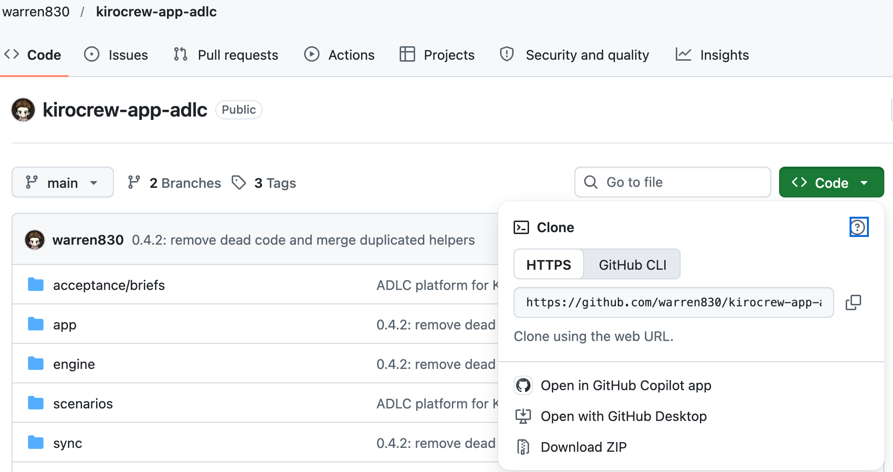
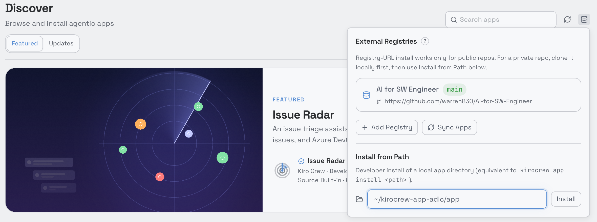
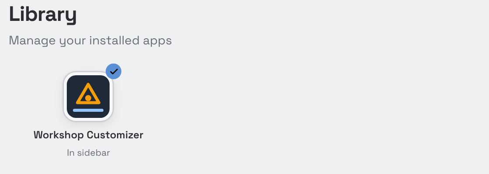
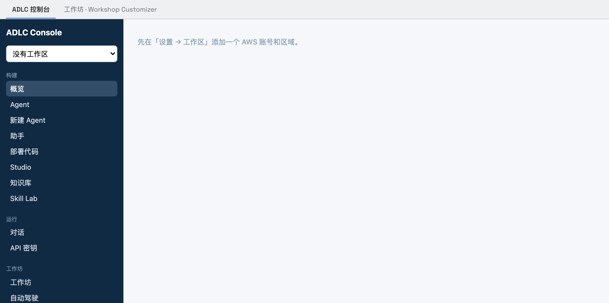
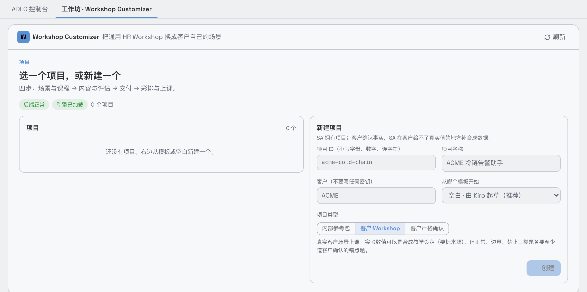
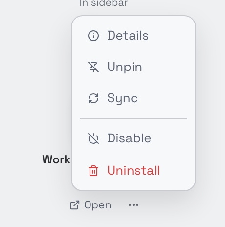
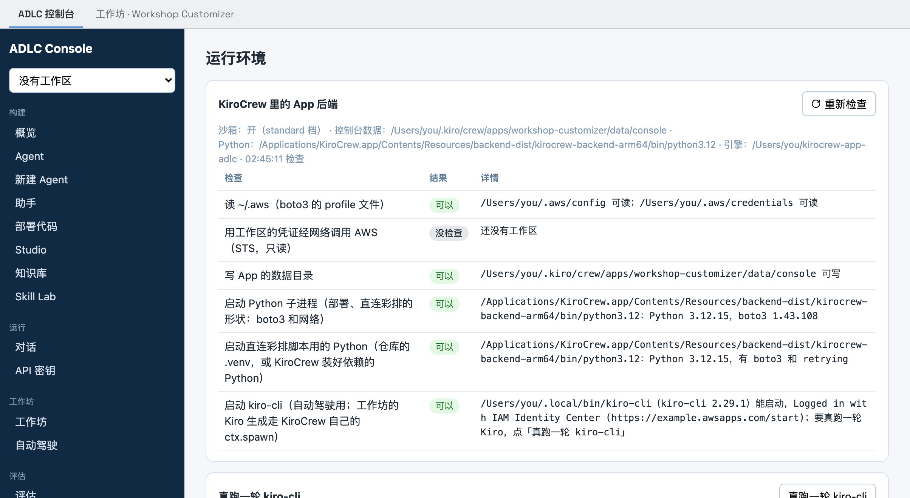

# ADLC 控制台 · ADLC Platform for KiroCrew

一个 KiroCrew App（`workshop-customizer`，版本 0.4.5）。装好后，KiroCrew 侧边栏里多一个「ADLC 控制台」：用 Amazon Bedrock
AgentCore 构建、评估、灰度发布 Agent，并把一份客户场景自动做成可以上课的 Workshop 场景包。

## What it does

**ADLC 控制台**
- **Agent**：Harness，Python zip、Dockerfile 或 ECR 镜像部署的代码 Agent，Claude Agent SDK Agent，Strands Studio 画布，以及会给出行为契约的架构助手。
- **知识库**：托管知识库、文档上传、检索试验台。挂到 Agent 时，每个 Agent 只看得到自己的知识库。
- **对话与 `/v1`**：多轮流式对话。对外 API 见下面的 Public API 一节。
- **评估**：契约多轮验证（带噪声带）、在线评估、批量评估、自定义裁判、AgentCore 优化建议。
- **A/B 与发布**：Harness 和代码 Runtime 都能按 5 → 25 → 50 % 走金丝雀。发布要同时满足三条：验证稳定、A/B 不比对照差到噪声带之外、期间比较的版本没改过。
- **Registry 与治理**：Agent Registry，Cedar 策略，以及限流和决策日志。
- **Skill Lab**：在真实 Agent 上有/无技能各跑一遍，测出提升，再训练并发布。
- **观测**：指标、会话和追踪，按需打分。
- **自动驾驶**：一份客户 brief 一键生成可以上课的场景包，依次是 Kiro 生成、门禁、构建、本地预测和多轮直连彩排。

**工作坊（Workshop Customizer）**
- Kiro 把客户场景写成场景包，确定性引擎校验并渲染，彩排后同步到 Workshop。
- 场景包改了、要同步进已经建好的 Workshop 环境时（彩排循环），先在 Workshop EC2 上运行 `./99-cleanup.sh --scenario-only`：只删这个场景的资源（Agent、Gateway、知识库、工具 Lambda、SSM 参数、评估记录），保留 `workshop-infra` 和附加组件；或者换一个新的 Workshop 环境。控制台不会替你执行删除。

## Requirements

- macOS 上的 KiroCrew 0.8 或更高版本。
- 本机装好并登录的 `kiro-cli`（`kiro-cli login`）：自动驾驶和工作坊的 Kiro 生成要用。
- 一个本地 AWS profile：控制台的「工作区」用它访问你的账号。区域要有 Bedrock AgentCore（例如 `us-west-2`），权限要能创建 AgentCore、Bedrock 知识库、IAM 角色和 S3 等资源。
- 网络能直连 GitHub。KiroCrew 匿名克隆 App，规则见注册表的说明；同时要能访问 AWS。

## Install

推荐的装法：先把仓库下载到本地，再从本地目录导入 KiroCrew。这样安装时 KiroCrew 不用联网，也不用额外安装任何包：后端用 KiroCrew 自带的 Python（已经有 boto3 等），建库脚本用到的 `retrying` 已经随仓库附带。

### 1. 下载

任选一种，放到一个固定的位置，例如 `~/kirocrew-app-adlc`：

- 用 git：`git clone https://github.com/warren830/kirocrew-app-adlc.git ~/kirocrew-app-adlc`
- 不用 git：在 GitHub 上点 **Code → Download ZIP**，然后解压。解压出来的文件夹叫 `kirocrew-app-adlc-main`，可以改名。



> App 装好以后直接从这个目录加载引擎，所以之后不要删除或移动它。

### 2. 导入 KiroCrew

打开 **Discover**，点右上角的 **Manage app sources**（刷新按钮右边的图标），在 **Install from Path** 里填仓库里的 **`app` 子目录**，例如 `~/kirocrew-app-adlc/app`，然后点 **Install**。



也可以用命令行：

```bash
kirocrew app install ~/kirocrew-app-adlc/app
```

> 路径要指到 `app/`，因为 `app.json` 在那里。填仓库根目录会报 `missing app.json`。

### 3. 启用并授予信任

打开 **Library**，找到 **Workshop Customizer**，点 **Enable**。新装的 App 还没启用，如果列表里没有，就点 **Show N disabled apps**。KiroCrew 会请你确认信任这个 App，信任的来源就是你刚才导入的本地目录；点信任以后，侧边栏会出现 **ADLC 控制台**。



### 4. 打开

**ADLC 控制台** 页面有两个页签：**ADLC 控制台** 是平台本身，**工作坊 · Workshop Customizer** 用来把客户场景做成 Workshop 场景包。





### 更新到新版本

在下载目录里运行 `git pull`（用 ZIP 的话，下载新版解压后覆盖同一个目录），然后在 **Library** 里点 **Workshop Customizer** 的 **⋯ → Sync**。App 的数据和信任都会保留。



> 卸载时 KiroCrew 默认保留 App 的数据（工作区、项目、控制台记录）。除非确实想清空，否则不要选择连数据一起删除。

### 另一种装法：从注册表安装

KiroCrew → **Discover → Manage app sources → Add Registry**，Repo 填 `https://github.com/warren830/AI-for-SW-Engineer`，Branch 填 `main`，然后在 Discover 里安装 **Workshop Customizer**。这种装法要求 KiroCrew 能直连 GitHub；如果安装时报 `git pull timed out`，改用上面的本地导入。

## First run

1. 打开侧边栏的 **ADLC 控制台**。
2. 在 **设置 → 运行环境** 里确认每一项都通过：AWS 配置文件、经网络调用 AWS（加了工作区以后才会检查）、数据目录可写、子进程、直连彩排用的 Python、`kiro-cli`。

   

3. 在 **设置 → 工作区** 里添加你的账号：账号 ID、区域、本地 profile，然后点「核对」。也可以用 `app/console/spoke-role.yaml` 接入另一个账号。
4. 可以从 **知识库** 开始，再新建 Agent、对话、验证，然后上 A/B。或者在 **自动驾驶** 里载入示例 brief 直接开跑，大约一小时。

控制台创建的资源都打上 `adlc:console=1` 标签，控制台只修改或删除带这个标签的资源。

## Public API

App 的后端在本机 `http://127.0.0.1:8772/v1` 提供控制台的对外 API。它不经过 KiroCrew 的网关，所以没有 30 秒限制，流式返回照常。每次调用都要带「API 密钥」页签发的密钥：

```bash
curl -s http://127.0.0.1:8772/v1/chat -H "X-Api-Key: $KEY" -H "Content-Type: application/json" \
  -d '{"agent": "<Agent 名称>", "message": "你好", "stream": true}'
```

`ADLC_PUBLIC_API_PORT` 可以换端口，设为 `0` 关闭。这个端口只响应本机。

## Development

```bash
python3 -m venv .venv && .venv/bin/pip install -r requirements-dev.txt
.venv/bin/python3 -m pytest -q                                          # the offline tests (no AWS)
.venv/bin/python3 app/console/server.py --port 8770 --data ~/.adlc-console # the console on its own, for development
```

## License

MIT-0（见 `LICENSE`）。`upstream/` 是 [aws-samples/sample-eval-first-building-enterprise-agents-with-agentcore](https://github.com/aws-samples/sample-eval-first-building-enterprise-agents-with-agentcore) 的随附副本，同为 MIT-0，见 `THIRD_PARTY_NOTICES.md`。
